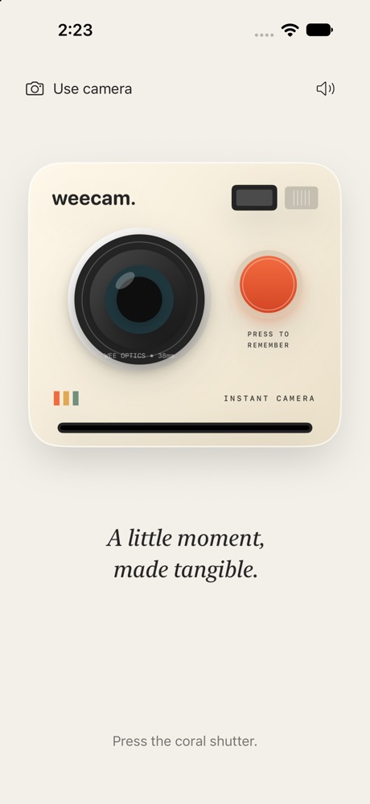
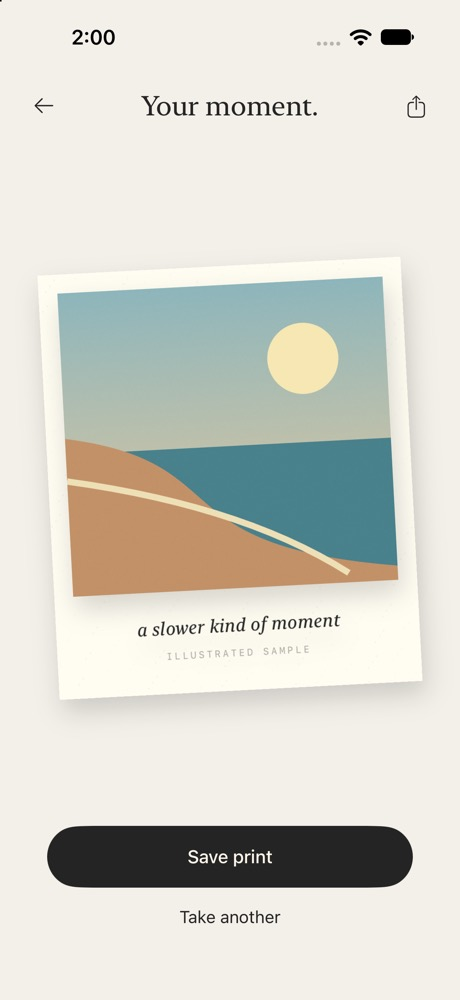

<div align="center">
  
  <h1>weecam</h1>
  <p><em>A little moment, made tangible.</em></p>
  <p>A playful instant camera for iPhone, built with SwiftUI.</p>
</div>

Take a photo, watch a print slide out, then give it a wee moment to develop. Once it’s ready, pick it up, have a wee look, and save or share it.

weecam is a small experiment in making a digital photograph feel like something you can hold. The little sounds, haptics and movements are all part of it.

<p align="center">
  
  &nbsp;&nbsp;
  
</p>

## Frame. Click. Wait a wee moment.

### Through the viewfinder

An original ivory camera with a chunky lens and a coral shutter. Tap **Use camera** to frame a real photograph, or try the illustrated sample straight away. A little flash, shutter click and haptic mark the moment.

### Into the darkroom

The print emerges, rotates into a quiet charcoal scene, and slowly develops. Over roughly seven seconds, colour deepens, contrast builds and details sharpen, with a little warmth and grain. Tap the print if you can’t wait.

### Yours to keep

Drag, rotate and tilt the finished print. Double-tap to settle it back into place, or hold it for its actions. **Save print** keeps a bordered copy in Photos; the share button opens the native iOS share sheet. **Take another** brings you back to the camera.

## Load the camera

You’ll need Xcode and an iPhone or iOS simulator. The app targets **iOS 17 or later** and has been built and tested with **Xcode 27.1**.

1. Clone this repository.
2. Open `weecam.xcodeproj` and select the `weecam` scheme.
3. Choose an iPhone simulator and press Run.
4. For a physical iPhone, select your own development team under **Signing & Capabilities**, then run on your device.

There are no third-party dependencies to install. Sample mode works offline and doesn’t need camera access. The simulator uses the sample; try a physical iPhone for live capture and haptics.

## A few small details

- **Sound:** the speaker button mutes the original shutter and print cues. When enabled, they use media volume and can play in Silent mode.
- **Motion:** the tagline and print entrances respect Reduce Motion. Finished prints respond to your fingers; device motion sensors aren’t required.
- **Permissions:** camera access is requested when you choose Use Camera. Photos access is add-only and requested when you save a print.
- **Returning later:** an exposed or finished print survives normal backgrounding. Development pauses, and the camera stops until you return. Prints stay in memory until the app closes; save to Photos to keep them permanently.
- **Sample prints:** the built-in illustration stays labeled on the print and its export.

## Inside the camera

| Part | Built with |
| --- | --- |
| Camera body, paper, gestures and spring motion | SwiftUI |
| Rear-camera preview and still capture | AVFoundation |
| Progressive blur, colour, contrast, warmth and grain | Core Image |
| Shutter and print audio | AVAudioPlayer |
| Tactile feedback | UIKit feedback generators |
| Saving finished prints | PhotoKit |

The capture sequence has five explicit states: `ready → capturing → printing → developing → finished`. The interface gives the camera, darkroom and finished print their own moments.

```text
Develop/
  DevelopApp.swift       App entry point
  DevelopView.swift      Camera, darkroom and finished-print scenes
  CaptureSession.swift   Capture lifecycle and state
  PhotoServices.swift    Camera, rendering, saving and feedback
  Assets.xcassets/       App icon
  Sounds/               Original camera cues
weecamTests/             Capture and rendering regression tests
```

The internal `Develop` names come from the experiment’s original working title.

## On the workbench

Choose **Product → Test** in Xcode with the `weecam` scheme and an iPhone simulator.

The 17-test regression suite covers capture sequencing, repeat shots, permission failures, interruption recovery, backgrounding, print preservation, image orientation, saving, audio assets and tap-to-reveal. Live camera operation and sound have also been tried on a physical iPhone.

Built as part of **Wee Interactions** — small native experiments, with attention to how they feel.
